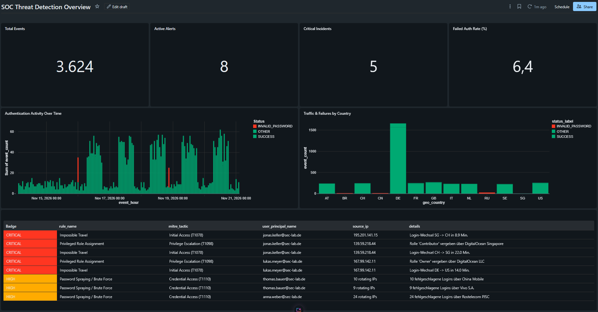
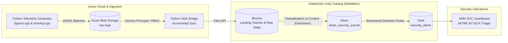

# Cloud Security Lakehouse & Threat Detection Pipeline


An end-to-end Cloud Security Data Engineering pipeline that ingests **Azure Entra ID (`SignInLogs`)** and **Azure Resource Manager (`ActivityLogs`)** telemetry into **Databricks Unity Catalog**, transforms raw events across a **Medallion Architecture (Bronze → Silver → Gold)**, and automatically detects multi-stage attacks mapped to the **MITRE ATT&CK** framework.

---

## SOC Dashboard Preview



---

## System Architecture



### Medallion Data Layers

| Layer | Unity Catalog Object | Description |
| :--- | :--- | :--- |
| **Landing Zone** | `security_lakehouse.bronze.landing_zone` | Managed Unity Catalog Volume receiving incremental `.jsonl` batches from Azure Blob Storage. |
| **Bronze** | `security_lakehouse.bronze.raw_security_events` | Raw immutable Delta table enriched with ingestion metadata (`_ingested_at`, `_source_file`). |
| **Silver** | `security_lakehouse.silver.clean_security_events` | Deduplicated events (`event_id`) with normalized timestamps, status labels, off-hours flags, and geolocation context. |
| **Gold** | `security_lakehouse.gold.security_alerts` | Actionable security incidents enriched with severity ratings, IoCs (`source_ip`), and MITRE ATT&CK mappings. |

---

## Implemented Threat Detections (MITRE ATT&CK)

| Detection Rule | MITRE Tactic & Technique | Severity | Detection Logic |
| :--- | :--- | :--- | :--- |
| **Password Spraying / Brute Force** | Credential Access (`T1110`) | `HIGH` | Detects `>= 5` failed authentication attempts (`status_code = 50126`) against a user across rotating source IPs and foreign ASNs. |
| **Impossible Travel** | Initial Access (`T1078`) | `CRITICAL` | Uses PySpark window functions (`LAG`) to flag successful logins (`status_code = 0`) for the same principal from different countries within `<= 60` minutes. |
| **Privileged Role Assignment** | Privilege Escalation (`T1098`) | `CRITICAL` | Monitors Azure ARM `roleAssignments/write` operations granting high-privilege RBAC roles (`Owner`, `Contributor`, `User Access Administrator`). |

---

## Repository Structure

```text
cloud-security-lakehouse/
├── databricks/
│   └── 01_security_lakehouse_etl.ipynb # PySpark Bronze → Silver → Gold ETL & detection rules
├── docs/
│   └── dashboard.png                   # Published Databricks AI/BI SOC dashboard
├── ingestion/
│   ├── generate_logs.py                # Telemetry generator (baseline traffic + 3 attack scenarios)
│   └── bridge_to_databricks.py         # Incremental Azure Blob → Unity Catalog Volume sync
├── .env.example                        # Environment variable template
├── .gitignore
└── requirements.txt                    # Python dependencies (azure-storage-blob, azure-identity, databricks-sdk)
```

---

## Quickstart & Setup

### 1. Prerequisites
* **Azure:** Storage Account with a `raw-logs` container and an Entra ID Service Principal assigned the `Storage Blob Data Contributor` role.
* **Databricks:** Workspace with Unity Catalog enabled (`security_lakehouse` catalog and `bronze` schema/volume).
* **Local Environment:** Python 3.11+.

### 2. Local Installation & Configuration
```powershell
git clone [https://github.com/c-karaali/cloud-security-lakehouse.git](https://github.com/c-karaali/cloud-security-lakehouse.git)
cd cloud-security-lakehouse

python -m venv .venv
.venv\Scripts\Activate.ps1
pip install -r requirements.txt

cp .env.example .env
```

Populate `.env` with your credentials:

| Variable | Description |
| :--- | :--- |
| `AZURE_TENANT_ID` | Microsoft Entra ID Tenant ID |
| `AZURE_CLIENT_ID` | App Registration / Service Principal Client ID |
| `AZURE_CLIENT_SECRET` | Service Principal Client Secret |
| `AZURE_STORAGE_ACCOUNT` | Azure Storage Account name |
| `AZURE_CONTAINER_NAME` | Target Blob container (default: `raw-logs`) |
| `DATABRICKS_HOST` | Databricks Workspace URL (`https://dbc-....cloud.databricks.com`) |
| `DATABRICKS_TOKEN` | Databricks Personal Access Token (PAT) |
| `DATABRICKS_VOLUME_PATH` | Target Unity Catalog Volume (`/Volumes/security_lakehouse/bronze/landing_zone`) |

### 3. Run Pipeline & Analytics
```powershell
# 1. Generate synthetic telemetry and upload batch to Azure Blob Storage
python ingestion/generate_logs.py

# 2. Incrementally sync new log files into Databricks Unity Catalog Volume
python ingestion/bridge_to_databricks.py
```

Finally, run `databricks/01_security_lakehouse_etl.ipynb` in your Databricks Workspace to populate the Bronze, Silver, and Gold Delta tables and refresh the SOC dashboard.